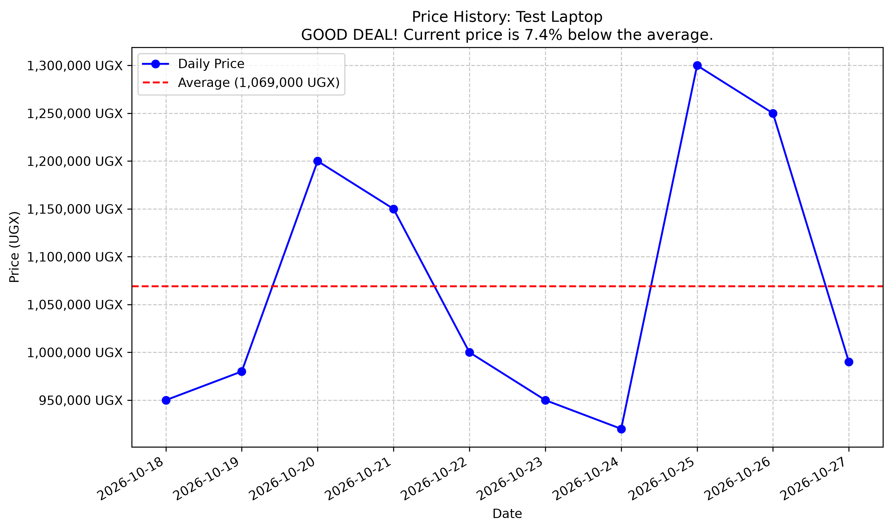

# Jumia Uganda Price Tracker

[](https://www.python.org/downloads/)
[](https://opensource.org/licenses/MIT)

## Project Overview

As a student living on a budget in Uganda, it's frustrating to see "SALE" tags on e-commerce sites like Jumia without knowing if it's a genuine discount. This tool automates price tracking by scraping product data from Jumia Uganda, storing historical prices, and analyzing whether current prices are above or below the average - helping you identify genuine deals.

This project demonstrates skills in **Web Scraping, Data Analysis, Data Visualization, and Clean Code Architecture**.

## Features

- **Web Scraping**: Scrapes product listings from Jumia Uganda across multiple categories with pagination support
- **Price Tracking**: Stores historical price data in CSV format for long-term tracking
- **Deal Analysis**: Compares current prices against historical averages to identify genuine discounts
- **Data Visualization**: Generates professional price history charts with moving averages
- **Modular Design**: Clean, reusable codebase organized for portfolio presentation
- **Multiple Approaches**: Includes both requests/BeautifulSoup and Selenium implementations

## Tech Stack

- **Python 3.8+**
- **[requests](https://docs.python-requests.org/)** - HTTP requests
- **[BeautifulSoup4](https://www.crummy.com/software/BeautifulSoup/)** - HTML parsing
- **[pandas](https://pandas.pydata.org/)** - Data manipulation and analysis
- **[matplotlib](https://matplotlib.org/)** - Data visualization
- **[Selenium](https://www.selenium.dev/)** - For dynamic content (optional)

## Project Structure

```
student-budget-assistant/
├── src/jumia_tracker/      # Core package
│   ├── __init__.py
│   ├── config.py           # Configuration and category URLs
│   ├── scraper.py          # Main scraping logic
│   ├── analyzer.py         # Price analysis and visualization
│   └── utils.py            # Utility functions
├── scripts/                # Utility scripts
│   ├── run_scraper.py
│   ├── run_analysis.py
│   ├── generate_test_data.py
│   └── health_check.py     # Selenium connectivity test
├── notebooks/              # Jupyter notebooks for exploration
│   ├── Data_scraping.ipynb
│   ├── main_scraper.ipynb
│   └── analysis.ipynb
├── data/
│   ├── raw/                # Raw scraped data
│   └── processed/          # Processed/cleaned data
├── tests/                  # Unit tests
├── main.py                 # CLI entry point
├── requirements.txt        # Dependencies
└── README.md
```

## Getting Started

### Prerequisites

- Python 3.8 or higher
- pip (Python package manager)

### Installation

1. Clone the repository:
```bash
git clone https://github.com/yourusername/jumia-uganda-price-tracker.git
cd jumia-uganda-price-tracker
```

2. Install required dependencies:
```bash
pip install -r requirements.txt
```

### Usage

#### Quick Start with CLI

```bash
# Generate test data to see how analysis works
python main.py generate-test

# Analyze the test data
python main.py analyze --csv data/raw/test_price_history.csv --product "Example Laptop"

# Test scrape (1 page per category - safe for testing)
python main.py scrape --max-pages 1

# Full scrape (all pages - use with caution)
python main.py scrape --max-pages -1
```

#### Using the Python API

```python
from jumia_tracker import JumiaScraper, analyze_prices

# Scrape products
scraper = JumiaScraper()
df = scraper.scrape_all_categories(max_pages_per_category=1)
df.to_csv('my_data.csv', index=False)

# Analyze prices
analyze_prices('data/raw/test_price_history.csv', 'My Product')
```

#### Using Jupyter Notebooks

Explore the `notebooks/` directory for interactive analysis and experimentation.

### Example Analysis



- **Blue Line:** The daily recorded price
- **Red Dashed Line:** The calculated average price

In this scenario, the script correctly identified that the current price was **7.4% below** the weekly average, indicating a genuine price drop.

## Important Notes on Web Scraping

- **Respect robots.txt**: Always check [Jumia Uganda's robots.txt](https://www.jumia.ug/robots.txt) before scraping
- **Rate Limiting**: This scraper includes delays between requests to be respectful
- **Terms of Service**: Ensure your scraping complies with Jumia's Terms of Service
- **Selectors May Change**: E-commerce sites frequently update their HTML structure
- **Anti-Bot Protection**: If you get blocked, consider using the Selenium approach in `scripts/health_check.py`

## Contributing

Feel free to fork this project, add more categories, improve the selectors, or enhance the analysis features!

## License

This project is licensed under the MIT License - see the LICENSE file for details.

## Acknowledgments

Built as a learning project to demonstrate practical web scraping and data analysis skills for a student budget-conscious use case.
