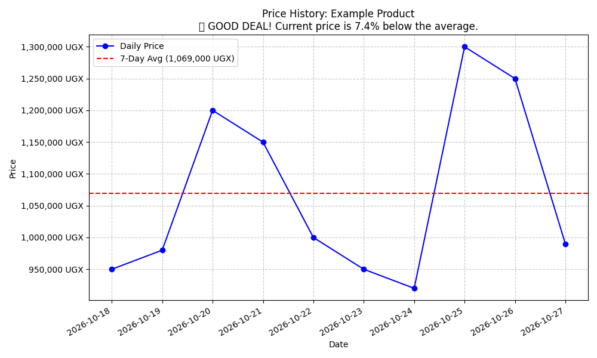

# 🇺🇬 Jumia Uganda Price Tracker 🤖📉

[](https://www.python.org/downloads/)
[](https://opensource.org/licenses/MIT)

## 📌 Project Overview
As a student living on a budget in Uganda, it's frustrating to see "SALE" tags on e-commerce sites like Jumia without knowing if it's a genuine discount. I built this automated tool to scrape a specific product's daily price and calculate its historical average to determine if a sale is actually worth buying.

This project demonstrates skills in **Web Scraping, Data Analysis, and Data Visualization**.

## 📊 Example Analysis
Here is a visualization generated by the tracker for a specific laptop over a 10-day period.



*   **Blue Line:** The daily recorded price.
*   **Red Dashed Line:** The calculated 7-Day Moving Average.

In this scenario, the script correctly identified that the current price was **7.4% below** the weekly average, indicating a genuine price drop.

## 🛠️ Tech Stack
*   **Python 3**
*   **Libraries:**
    *   `requests` (Fetching webpage HTML)
    *   `beautifulsoup4` (Parsing HTML and extracting data)
    *   `pandas` (Storing data in CSV and calculating averages)
    *   `matplotlib` (Generating time-series charts)

## 🚀 Getting Started

### Prerequisites
You need to have Python installed on your machine. Install the required libraries:

```bash
pip install requests beautifulsoup4 pandas matplotlib